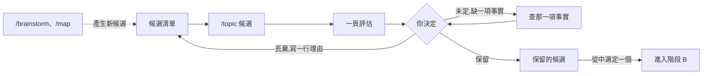
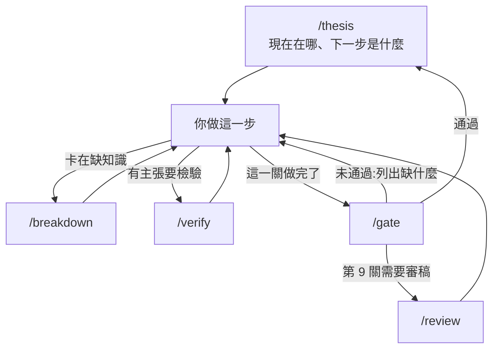

# researchy 使用指南

最後更新:2026-11-22

這份指南說明這套 skill 能做什麼、不能做什麼,以及實際使用時的流程。每次新增、移除或改變 skill 的用法時,這份文件會跟著更新。

## 1. 這是什麼

researchy 是一組在 Claude Code 裡使用的 skill,輔助研究生完成一篇論文:從還不知道要做什麼,到交出稿子。

它做兩件事:

- **當你的教授**:告訴你下一步、幫你排除困難、在你的推理有問題時直接說。
- **當你的實驗室**:用硬性規格檢查你的成果,並實際執行能執行的檢查。

論文的實質內容由你自己寫:研究問題、假設、主張、論證。agent 做周圍的苦工,例如查資料、找段落、跑檢查、記錄。

## 2. 快速開始

你現在處於哪個情況,就從那一行開始:

| 你的情況 | 輸入 |
|---|---|
| 還不知道論文要做什麼 | `/topic` |
| 有一個想法,想知道能不能當題目 | `/topic <你的想法>` |
| 想天馬行空地發想 | `/brainstorm <想法>` |
| 題目定了,不知道下一步 | `/thesis` |
| 某個東西看不懂,卡住了 | `/breakdown <看不懂的東西,以及為什麼需要它>` |
| 想確認一個主張或定理對不對 | `/verify <主張>` |
| 覺得某個階段做完了 | `/gate` |
| 想知道審稿人會怎麼說 | `/review <檔案>` |

## 3. 階段 A:找題目

### 流程

### 一次評估會發生什麼

1. 你輸入 `/topic <候選>`。
2. agent 先查資料。它會開啟定義這個題目的兩三篇論文,並搜尋最近十二個月有沒有人已經做掉。這時你不用讀任何東西。
3. agent 交給你一頁,固定九段:
   - 一句話:這個題目在問什麼
   - 這個領域在做什麼
   - 需要的知識:哪些你有、哪些沒有、補起來要多久
   - 缺口還在嗎
   - 一年內做得完嗎
   - 需要的資源
   - 最可能失敗的原因
   - 對照判準
   - 結論
4. 你讀這一頁。看不懂的地方直接問。
5. agent 逐項對照判準,直接說哪幾項不符合。
6. 你下結論:保留、丟棄、或未定。

### 你可以調整的

- **判準與限制**寫在 `topics/criteria.md`。目前是:一年完成、理論與實證都要有、不限指導教授、六項判準。直接改這個檔案就會生效。
- **候選清單**在 `topics/candidates.md`。你可以自己加一行。

### 這個階段的規則

- 每次評估的上限是你坐下來一次的時間。到時間還定不了,就記為「未定」並寫明缺哪一項事實。
- 被丟棄的題目會留在清單上並附理由,之後條件改變可以重開。
- 你下了結論並給了理由之後,agent 不會重複提同一個反對意見,除非出現新的事實。

## 4. 階段 B:做論文

### 流程

### 九個關卡

論文依序通過九關。每一關的必要條件、要交的證據、常見的失敗都寫在 `docs/gates.md`。

| 關卡 | 名稱 | 這一關要抓的錯 |
|---|---|---|
| 1 | 問題陳述 | 問題太大、貢獻無法檢驗、沒有停損條件 |
| 2 | 相關研究定位 | 「沒有人做過」其實沒查 |
| 3 | 模型 | 假設藏在文字裡、符號意思不一致 |
| 4 | 假設一致性 | 假設互相矛盾 |
| 5 | 主張 | 主張無法被推翻、看到資料才寫假說 |
| 6 | 理論驗證 | 證明用了沒列出的假設、只驗證自己挑的例子 |
| 7 | 實證設計 | 看到結果才選指標、比較對象不公平 |
| 8 | 實證結果 | 數字無法重新產生、只報告最好的一次 |
| 9 | 論文稿與內部審稿 | 緒論宣稱的比做到的多、引用的論文沒說那句話 |

這套關卡是為「理論加實證」的論文寫的。你的指導教授或系所的規定優先;告訴 agent,它會修改 `docs/gates.md`。

你可以強行跳過某一關。跳過會連同你的理由記在 `thesis/status.md`。

### 每個 skill 在做什麼

**`/thesis`:下一步是什麼**

第一次使用時,它會建立 `thesis/status.md`,並從期限往回排出每一關的目標月份。之後每次使用,它只回三件事:目前在哪、下一步(一個坐下來能做完的動作)、進度有沒有落後。

**`/breakdown`:看不懂的時候**

這是「由上往下拆、一次讀一小塊、再回饋」的循環:

1. 你說你需要懂什麼,以及為什麼需要。
2. agent 從這個需要往下拆,拆到每一塊大約三十分鐘能讀完,並指向具體的段落。你已經會的會被略過。
3. agent 一次給你一到三塊。每一塊先是五到十行的簡短說明,再附原文的位置。
4. 你讀完回一句話:懂了、卡在哪裡、或這不是我需要的。
5. agent 依你的回答調整:標記完成、把那一塊拆得更細、或拿掉整個分支。

你只需要回一句話。沒有測驗,也不要求你寫摘要。

**`/verify`:實際跑一個檢查**

| 要檢驗的東西 | 它怎麼做 |
|---|---|
| 數學陳述(定理、不等式) | 先跟你把陳述寫精確,再用程式在小規模例子上找反例;必要時用符號運算或 solver |
| 一組假設 | 嘗試構造一個同時滿足全部假設的例子;構造不出來就找出哪兩條衝突 |
| 實證結果 | 從原始資料重新跑一次,比對數字 |
| 引用(「某論文證明了某事」),或整份參考文獻 | 先比對論文是否存在,再開啟論文找出支持的段落 |

每次檢查都會留下腳本與紀錄在 `thesis/checks/`,任何人都能重跑。

**`/gate`:這一關過了沒**

它逐條對照 `docs/gates.md` 的必要條件,每條回答符合、不符合、或無法檢查,並指出證據在哪個檔案。它看的是檔案裡的證據,不是你說你做了什麼。沒過的話,你會得到一份「缺什麼」的清單,依重要性排列。

**`/review`:外部審稿人**

它在獨立的環境裡執行,看不到你和 agent 的對話,只看文件本身。審查報告包含:文件宣稱了什麼、弱點(分成「已確認」與「懷疑」)、給作者的問題、哪些部分確實站得住、建議。

**`/calibrate`:檢查器本身可不可靠**

在你開始依賴 `/review`、`/gate`、`/verify` 之前,可以先測它們。做法是在文件的副本裡植入已知的錯誤,看檢查器抓到幾個、在沒有錯的版本上又誤報了什麼。結果記在校準紀錄裡。這個動作成本較高(見第 7 節)。

### 被你拒絕的建議不會重複出現

你拒絕某個建議時,agent 會在 `thesis/declined.md` 記一行:建議是什麼、你的理由、什麼情況下該重新考慮。之後 `/thesis`、`/gate`、`/review` 都會先讀這份清單。同一個意見只會在「重新考慮的條件」發生時再被提出。

有一個例外:`/gate` 的必要條件不會因為你拒絕而消失。它仍會回報「不符合」,但會註明你之前拒絕過,而且不再爭論。

## 5. 你做什麼,agent 做什麼

| 你做 | agent 做 |
|---|---|
| 決定題目的去留 | 查資料、寫一頁評估、對照判準 |
| 寫研究問題、假設、主張、論證 | 找來源、指出漏洞、建議結構 |
| 讀被拆小的知識,回一句話 | 拆解、找出具體段落、依回饋調整 |
| 決定要不要跳過某一關 | 逐條檢查必要條件、記錄跳過的理由 |
| 判斷檢查結果代表什麼 | 寫檢查腳本、執行、如實回報 |
| 問真正的指導教授 | 幫你準備好要問的那一頁 |

## 6. 怎麼讀 agent 給你的內容

每條事實陳述前面都有一個標籤,說明它被查到哪一級:

| 標籤 | 意思 | 你該怎麼看待 |
|---|---|---|
| `quote-verified` | 引句已在原文中找到 | 可以引用,但「這句話是否支持你的論點」仍由你判斷 |
| `source-exists` | 來源在這次 session 開啟過,內容沒有逐句比對 | 論文存在,細節要自己確認 |
| `model-only` | 模型自己說的,沒有查證 | 當成線索,不要當成事實 |

論文從三個地方找:

| 來源 | 用來做什麼 |
|---|---|
| **Consensus** | 用一句話搜尋已發表的論文,包含不在 arXiv 上的會議與期刊論文 |
| **OpenAlex** | 搜尋論文;一次比對整份參考文獻是否存在;列出「誰引用了這篇」,由新到舊 |
| **arXiv** | 最新的預印本;而且是唯一讀得到全文的地方 |

只讀到摘要或索引紀錄時,標籤是 `source-exists`。

沒有標籤的事實陳述,請當成 `model-only`。

## 7. 它做不到的事

- **判斷學界在不在意這個題目**,以及結果夠不夠拿學位。這要問你真正的指導教授。
- **保證一個證明是對的。** `/verify` 能找反例、能逐步檢查。「沒找到反例」不等於「證明成立」。
- **可靠地判斷哪個問題最嚴重。** 這是實測的結果,見下一節。
- **讀 arXiv 以外論文的全文。** 找論文、確認論文存在、順著引用找,這三件事都做得到。但全文只有 arXiv 上有 HTML 版本的論文讀得到;其餘只能讀到摘要,相關陳述最高只到 `source-exists`。
- **使用 Google Scholar、DBLP、Semantic Scholar。** 2026-11-22 都測過:Google Scholar 被網路設定擋下,而且沒有官方 API;DBLP 對自動化請求回傳驗證頁面;Semantic Scholar 連得到,但沒有 API 金鑰時會被限流。
- **阻止自己出錯。** 它只能把沒查證的部分標出來。

**成本。** 多數 skill 的成本跟一般對話差不多。兩個例外:`/review` 會啟動一個獨立的 agent;`/calibrate` 每個副本啟動一個,第一次校準四個副本合計用了約 34 萬 token。`/calibrate` 執行前會先告訴你要跑幾個。

## 8. 目前驗證到什麼程度

| 項目 | 狀態 |
|---|---|
| 腳本 | 19 個自動測試全部通過 |
| `/topic` | 實際跑過兩次,各產出一頁 |
| `/review` 的指示 | 校準過一次(見下) |
| `/thesis`、`/breakdown`、`/gate`、`/verify` | **寫好了,還沒實際跑過** |
| `/calibrate` | 手動照著它的步驟跑過一次;skill 本身沒被呼叫過 |
| `/brainstorm`、`/map`、`/lookup` | `/map` 跑過一次,其餘沒跑過 |
| 九個關卡的內容 | 在有真實題目之前寫的,實際使用後很可能需要修改 |
| 「被拒絕的建議不重複」 | 寫好了,還沒實際發生過 |

**`/review` 的校準結果(2026-11-22)。** 在一份很短的範例文件裡植入三個錯誤,由四個不知情的獨立 agent 審查:

- 三個錯誤都被指出了位置。
- 對照組(沒有錯誤的版本)沒有被判定有嚴重問題。
- **嚴重度的排序不可靠。**「定理少了必要條件」被排在「模擬缺少程式碼」之後。
- **每份報告都有大約八項小意見,不論文件好壞。** 所以「審查者提了很多意見」不代表文件有問題。

這次校準之後,我修改了 `/review` 的指示來處理後兩點。**修改後還沒有重新校準**,所以不知道有沒有改善。完整紀錄在 `topics/calibration/LEDGER.md`。這只是三個錯誤、一份短文件的結果,不能推論到真實的論文稿。

## 9. 常見狀況

**agent 給的東西太多、太長。**
直接說。這套工具的原則是每一步只有一頁、一個決定。之前的設計曾經因為步驟太多而讓學習變慢,所以這一點寫進了專案規則。

**agent 一直稱讚我的想法。**
這是失效的徵兆。教授角色的指示是直接批評、不為了客氣而稱讚。請指出來。

**我不同意某一關的要求。**
兩個做法:跳過並寫下理由,或者直接修改 `docs/gates.md`。如果是指導教授或系所的規定不同,請用後者。

**某個判斷標示為「無法判斷」。**
通常是因為只讀得到摘要、讀不到全文,或缺一項只有你或教授知道的事實。那一頁會寫明缺的是什麼。

**雲端環境重開之後。**
`papers/` 裡下載的論文不在 git 裡,會消失;需要時 agent 會重新下載。其他檔案都在 git 裡。

## 10. 檔案在哪裡

| 路徑 | 內容 |
|---|---|
| `topics/criteria.md` | 你的限制與判準 |
| `topics/candidates.md` | 候選清單與每個的狀態 |
| `topics/<代號>.md` | 每個候選的一頁評估 |
| `thesis/status.md` | 九關的狀態與時程 |
| `thesis/` 其他 | `problem.md`、`related.md`、`model.md`、`claims.md`、`experiments.md`、`proofs/`、`checks/`、`results/`、`draft/`、`reviews/`、`knowledge.md`、`declined.md` |
| `docs/gates.md` | 九個關卡的硬性規格 |
| `ideas/`、`maps/` | 發想筆記、領域地圖 |
| `PARKED.md` | 擱置的問題 |
| `papers/` | 下載的論文(不進 git) |

## 11. 雲端環境

在 Claude Code 雲端使用這個專案時,選名為 `researchy` 的環境。它包含:

- **網路**:可連 `github.com`、`arxiv.org`、`export.arxiv.org`,以及套件庫與已接上的連接器(Consensus、OpenAlex)。
- **啟動腳本**:安裝 `pyyaml`、`pytest`、`sympy`、`z3-solver`。前兩個是專案腳本與測試用的;後兩個是 `/verify` 做符號運算與檢查假設是否矛盾用的。

Consensus 和 OpenAlex 是你帳號上的連接器,不屬於環境設定。新的 session 要能使用它們,連接器必須維持接上的狀態。

## 12. 另外可用的 skill

這三個不在主線上,需要時可以用:

- `/lesson <概念>`:完整地學一個概念,先預測、再講解、最後用自己的話重述。適合需要長期記住的核心概念。
- `/read <arXiv 編號>`:為整篇論文建立閱讀指南,依先備關係重排順序。適合需要從頭到尾讀懂的關鍵論文。
- `/lookup <詞>`:從你自己的筆記裡 recap 學過的東西。
