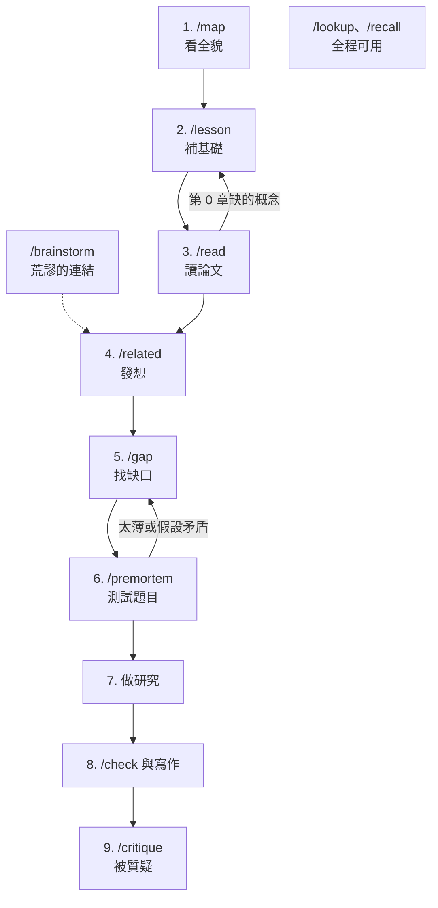

# researchy:設計與學習流程報告

狀態日期:2026-11-22

## 0. 方向調整(2026-11-22)

實際試用後,學習者回報閱讀頁面與每個單元的預測題讓學習的負擔變重了。原因是設計從「一篇論文」出發,而不是從學習者的目的出發。

調整後的主線分成兩個階段:

- **階段 A:找題目。** 用 `/topic` 一次評估一個候選題目,每個只產出一頁,結論是保留或丟棄。判準與限制寫在 `topics/criteria.md`。
- **階段 B:做論文。** 閱讀、建立模型、驗證、寫作。以一連串有明確通過條件的關卡進行。尚未建置,等有選定的題目後再做。

agent 有兩個角色:**教授**(指出下一步、排除困難、該批評時批評)與**實驗室**(硬性規格與可實際執行的檢查)。

以下第 1 到 8 節描述的是調整前的設計。其中的 `lesson`、`read`、`map` 與閱讀頁面仍可使用,但不再是主線。

## 1. 定位

researchy 是一組 Claude Code skill,輔助研究生走完研究過程:認識一個領域、讀論文、找題目並測試它、實際做研究。它是輔助工具,重點放在學習者的舒適度,以及減少研究過程中的痛點。它不代替學習者思考。

## 2. 四個設計原則

1. **勞力歸 agent,判斷歸學習者。** 搜尋、抓取、排序、查證、記錄由 agent 做。理解、選題、論證由學習者做,agent 只在之後補充或反駁。
2. **每條陳述都標示查到哪一級。** 目標不是阻止幻覺(做不到),而是讓它看得見。
   - `quote-verified`:引句已在原文中找到。
   - `source-exists`:來源已在本次 session 開啟,內容未逐句比對。
   - `model-only`:模型自己說的,沒有查證。
3. **學習者先答。** 學概念前先預測,讀單元前先回答一個問題,之後用自己的話重述。卡片上記的是學習者自己的話。
4. **偏題要看得見,但不禁止。** 支線先簡短回答再擱置,學習者決定要不要追。`/brainstorm` 是例外,那裡發散就是方法。

## 3. 目前的 skill

| Skill | 用途 | 產出 | 狀態 |
|---|---|---|---|
| `/map <主題>` | 把大主題拆成一堂課大小的方向 | `maps/<name>.md` | 已建,已用於 TFM |
| `/lesson <主題>` | 一次學一個概念:預測、講解、重述 | `lessons/NNNN-*.md`、概念卡片 | 已建,尚未跑完一堂 |
| `/read <arXiv 編號>` | 用閱讀指南讀論文,追引用時保留位置 | `guides/<id>.md`、閱讀頁面、論文卡片 | 已建;指南與頁面已做,共讀流程未跑 |
| `/lookup <詞>` | 從自己的筆記 recap 學過的東西 | 無 | 已建,未跑 |
| `/brainstorm <想法>` | 認真討論荒謬的跨領域連結,先不評價 | `ideas/NNNN-*.md` | 已建,未跑 |

**已設計、未建**

| Skill | 用途 |
|---|---|
| `/related` | 發想用的相關研究工作文件,每條帶等級標籤 |
| `/gap` | 把論文卡片排成表,空格即候選題目 |
| `/premortem` | 投入前測試題目:厚度、假設一致性、停損條件 |
| `/check` | 把 `source-exists` 升為 `quote-verified` |
| `/recall` | 回想練習 |
| 階段 7 | 做研究時的輔助,尚未設計 |

## 4. 檔案與工具

| 路徑 | 內容 |
|---|---|
| `library/` | 概念卡片與論文卡片,平放。分類與關聯寫在卡片裡,`INDEX.md` 由腳本產生 |
| `lessons/` | 每堂課的過程:猜測、講解、擱置的問題 |
| `maps/` | 主題地圖 |
| `guides/` | 論文閱讀指南 |
| `ideas/` | Brainstorm 筆記,整份視為推測 |
| `papers/` | 下載的論文與產生的閱讀頁面。**不進 git**,因為多數論文可讀但不可再散布 |
| `PARKED.md` | 擱置的問題 |
| `CLAUDE.md` | 專案規則:給學習者讀的內容一律用繁體中文 |

| 腳本 | 作用 |
|---|---|
| `scripts/library.py check` / `index` | 驗證卡片;重建 `INDEX.md` |
| `scripts/arxiv.py meta` / `get` | 確認論文存在;下載全文 |
| `scripts/build_reader.py <id>` | 把論文和閱讀指南組成反白說明頁面 |

卡片之間的關聯有五種:`prerequisite`、`special-case-of`、`used-in`、`related`、`contrasts-with`。連到還沒有卡片的概念不算錯誤,它們列在索引的 Frontier 區,代表「知道存在但還沒學」。

## 5. 學習場景的流程

| 階段 | 學習者做什麼 | Skill | 狀態 |
|---|---|---|---|
| 1. 看全貌 | 問這個領域有哪些方向,選一個 | `/map` | 已建 |
| 2. 補基礎 | 先預測,聽講解,用自己的話重述 | `/lesson` | 已建 |
| 3. 讀論文 | 先看第 0 章缺什麼;照指南順序讀原文;看不懂就反白 | `/read` | 已建 |
| 4. 發想 | 看別人怎麼做,討論哪裡能延伸 | `/related`、`/brainstorm` | 部分 |
| 5. 找缺口 | 看論文卡片排成的表,判斷哪個空格值得做 | `/gap` | 未建 |
| 6. 測試題目 | 寫理想狀況的摘要、列假設、定停損條件;拿一頁紙問指導教授 | `/premortem` | 未建 |
| 7. 做研究 | 證明、實驗、資料分析 | 未設計 | 未建 |
| 8. 寫作 | 寫稿,每個引用過查證 | `/check` | 未建 |
| 9. 被質疑 | 全新 session 扮演審稿人 | `/critique` | 只有想法 |

### 一堂 lesson 內部

訂主題與一句範圍 → 學習者先預測 → agent 講解(每條陳述帶等級)→ 學習者用自己的話重述 → 產生卡片。

途中的問題分三種:

- **主題內**:直接回答。
- **缺口**(不懂它就跟不上):用幾句話補上,再回到原處。
- **支線**(有趣但非必要):簡短回答後記入 `PARKED.md`。

同一條支線追問第二次,或一個缺口又帶出另一個缺口時,agent 提醒已偏題,由學習者決定擱置或換主題。

### 讀一篇論文的內部

1. 學習者給 arXiv 網址或編號。`arxiv.py get` 下載論文。
2. agent 讀過原文後建閱讀指南:把論文切成單元,找出每個單元需要什麼,排成「先備在前」的順序。論文用到但沒解釋、library 裡也沒有的概念列在第 0 章。
3. `build_reader.py` 把論文和指南組成閱讀頁面,發布為私人 artifact。
4. 學習者在頁面上一次讀一個單元的**原文**。讀之前先回答該單元的問題。
5. 看不懂的地方就反白,取得即時說明(標示為 `model-only`)。提問會自動存下來。
6. 追引用時 agent 記下出發的那句話,在被引用的論文裡找出支撐它的段落,學習者讀完後回到原處。
7. 回到對話。agent 讀回頁面上的提問與答案,整理成卡片或擱置的問題。
8. 結束時產生論文卡片,固定記錄假設與作者自己說的未解問題。這兩欄是之後找缺口的原料。

## 6. 已經實際做過的

以 transaction fee mechanism(TFM)為例,走了前三個階段的一部分:

- **地圖**:`maps/transaction-fee-mechanisms.md`,八個方向。13 篇論文經 arXiv API 確認存在;七個方向為 `source-exists`,MEV 方向仍是 `model-only`。
- **閱讀指南**:`guides/2106.01340.md`(Roughgarden, *Transaction Fee Mechanism Design*)。agent 完整讀了第 2、3 節,前 10 個單元據此建立;其餘單元只根據標題,標示為暫定。
- **閱讀頁面**:含論文全文、16 個單元卡片、第 0 章、反白說明、提問紀錄。只有擁有者看得到。這篇論文的授權不允許再散布,所以頁面不可分享。
- **Lesson 0001**:已開場,停在學習者的預測。

## 7. 驗證到什麼程度

| 項目 | 驗證方式 | 結果 |
|---|---|---|
| 腳本(`library.py`、`arxiv.py`、`build_reader.py`) | 19 個自動測試 | 全部通過 |
| arXiv 抓取 | 對真實論文執行 | 可用 |
| 閱讀頁面的版面與反白流程 | 瀏覽器測試,桌機與手機寬度,用假的 Claude 介面 | 通過,無錯誤訊息 |
| 閱讀頁面向真正的 Claude 提問 | 無法由 agent 測試,需學習者在頁面上操作 | **未驗證** |
| 閱讀頁面的資料庫 | 發布後讀取兩個集合 | 可讀取,目前為空 |
| 所有 skill 的對話流程 | 只有實際使用才能驗證 | **多數未驗證** |

## 8. 已知的缺口

1. **後半段是空的。** 階段 5 到 9 沒有可用的 skill。
2. **`quote-verified` 還沒有任何東西能產生。** `/check` 未建,所以目前最高只到 `source-exists`。
3. **階段之間的銜接沒測過。** 例如 `/gap` 假設論文卡片的欄位一致,但還沒有任何論文卡片存在。
4. **重排的效果只在一篇論文上看過。** 那篇本身很有條理,重排幅度很小,主要價值在第 0 章。對結構較亂的論文是否更有用,未知。
5. **依賴關係是 agent 推測的。** 閱讀指南的順序可能有錯;每個單元都指回原文,可以核對。
6. **反白說明沒有記憶,也不會提醒偏題。** 它只看得到反白的段落和周圍文字,看不到 library。
7. **只支援 arXiv 上有 HTML 版本的論文。** PDF 與其他網站尚未支援。
