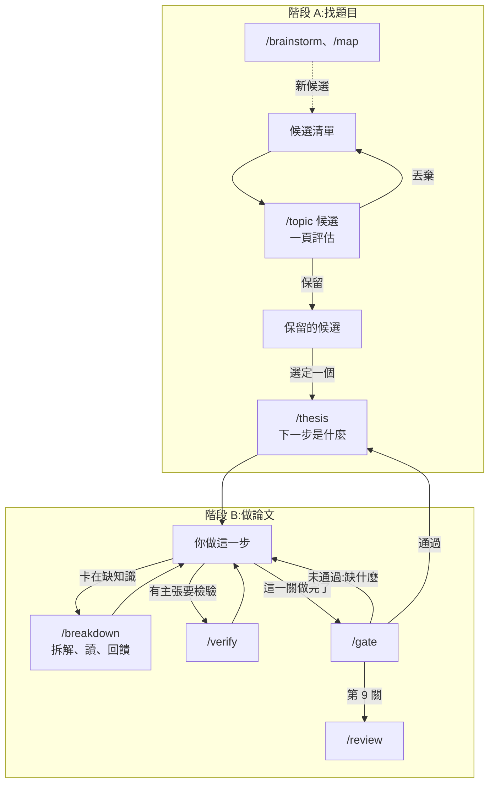

# researchy:設計與使用流程

狀態日期:2026-11-22

## 1. 這是什麼

researchy 是一組 Claude Code skill,輔助研究生完成一篇論文:從還不知道要做什麼,到交出稿子。它是輔助工具,目標是減少研究過程中的痛點,並且不增加學習者的負擔。論文的實質內容(問題、假設、主張、論證)由學習者自己寫。

## 2. 兩個階段

**階段 A:找題目。** 從大方向收斂到一個精準的題目。這是一個反覆的搜尋:提出候選、查到足以判斷的程度、保留或丟棄、換下一個。

**階段 B:做論文。** 題目選定後,閱讀、建立模型、驗證、寫作。這段最長,也最常出錯,所以切成九個關卡,每一關有明確的必要條件。

## 3. agent 的兩個角色

| 角色 | 做什麼 | 對應的 skill |
|---|---|---|
| **教授** | 告訴你下一步、排除困難、在該批評時批評、在你會重複犯的錯上教你 | `/topic`、`/thesis`、`/breakdown` |
| **實驗室** | 用硬性規格檢查你的成果;實際執行可以執行的檢查 | `/gate`、`/verify`、`/review` |

## 4. 全部的 skill

### 階段 A

| Skill | 用途 | 產出 |
|---|---|---|
| `/topic` | 看目前有哪些候選、建議下一個評估誰 | 無 |
| `/topic <候選>` | 評估一個候選題目:agent 先查資料,寫成一頁,逐項對照判準,由你決定保留或丟棄 | `topics/<代號>.md` |
| `/brainstorm <想法>` | 認真討論看似荒謬的跨領域連結,先不評價。用來產生新的候選 | `ideas/NNNN-*.md` |
| `/map <領域>` | 把一個大領域拆成幾個方向。用在候選還太大的時候 | `maps/<name>.md` |

### 階段 B

| Skill | 用途 | 產出 |
|---|---|---|
| `/thesis` | 目前在哪一關、缺什麼、下一步做什麼(一次只給一步) | `thesis/status.md` |
| `/breakdown <需要>` | 某一步卡在缺知識時,由上往下拆到夠小,一次讀一塊,你回一句話,agent 調整 | `thesis/knowledge.md` |
| `/gate` | 對照 `docs/gates.md` 檢查目前這一關,逐項回答符合、不符合或無法檢查 | 更新 `thesis/status.md` |
| `/verify <主張>` | 實際執行一個檢查:找反例、檢查假設是否一致、重新產生一個結果、確認引用的論文真的說了那句話 | `thesis/checks/` 的腳本與紀錄 |
| `/review <檔案>` | 由沒看過這段對話的審稿人審一份文件 | `thesis/reviews/` |

### 另外可用,但不是主線

`/lesson`(學一個概念)、`/read`(用閱讀指南讀整篇論文)、`/lookup`(從自己的筆記 recap)。

## 5. 流程

### 階段 A 的一次評估

1. 你輸入 `/topic <候選>`。
2. agent 先查資料:開啟定義這個題目的兩三篇論文,查這個缺口最近十二個月是否還在。這時你不用讀任何東西。
3. agent 寫出一頁:一句話、這個領域在做什麼、需要的知識、缺口還在嗎、一年內做得完嗎、需要的資源、最可能失敗的原因、對照判準、結論。
4. 你讀這一頁,有問題就問。
5. agent 逐項對照 `topics/criteria.md`,直接說哪幾項不符合。
6. 你下結論。清單更新。

每次評估的上限是你坐下來一次的時間。到時間還定不了,記為「未定」並寫明缺哪一項事實。

### 階段 B 的日常

1. 你輸入 `/thesis`。agent 回三件事:目前在哪、下一步(一個坐下來能做完的動作)、進度有沒有落後。
2. 你做那一步。
3. 卡在看不懂某個東西時,用 `/breakdown`。agent 從「你為什麼需要它」往下拆,每塊約三十分鐘能讀完,並指向具體的段落。每塊先給五到十行的簡短說明,再給原文位置。你讀完回一句話:懂了、卡在哪、或這不是我需要的。
4. 有一個主張想確認時,用 `/verify`。
5. 覺得這一關做完了,用 `/gate`。沒過就會得到一份「缺什麼」的清單。

## 6. 九個關卡

完整的必要條件、要交的證據、常見的失敗寫在 `docs/gates.md`。這裡只列名稱:

| 關卡 | 名稱 | 這一關要抓的錯 |
|---|---|---|
| 1 | 問題陳述 | 問題太大、貢獻無法檢驗、沒有停損條件 |
| 2 | 相關研究定位 | 「沒有人做過」其實沒查 |
| 3 | 模型 | 假設藏在文字裡、符號意思不一致 |
| 4 | 假設一致性 | 假設互相矛盾,之後的定理在空集合上成立 |
| 5 | 主張 | 主張無法被推翻、看到資料才寫假說 |
| 6 | 理論驗證 | 證明用了沒列出的假設、只驗證自己挑的例子 |
| 7 | 實證設計 | 看到結果才選指標、baseline 不公平 |
| 8 | 實證結果 | 數字無法重新產生、只報告最好的一次 |
| 9 | 論文稿與內部審稿 | 緒論宣稱的比做到的多、引用的論文沒說那句話 |

這套關卡是為「理論加實證」的論文寫的。你可以強行跳過某一關,那會連同理由被記下來。

## 7. 檔案

| 路徑 | 內容 |
|---|---|
| `topics/` | 找題目:`criteria.md`(限制與判準)、`candidates.md`(候選清單)、每個候選一頁 |
| `thesis/` | 做論文:`status.md`(九關的狀態)、`problem.md`、`related.md`、`model.md`、`claims.md`、`experiments.md`、`proofs/`、`checks/`、`results/`、`draft/`、`reviews/`、`knowledge.md` |
| `ideas/`、`maps/` | Brainstorm 筆記;領域地圖 |
| `docs/gates.md` | 九個關卡的硬性規格 |
| `papers/` | 下載的論文。不進 git,因為多數論文可讀但不可再散布 |
| `PARKED.md` | 擱置的問題 |
| `CLAUDE.md` | 專案規則:語言、兩個角色、低負擔原則 |

每條事實陳述都標示查到哪一級:

- `quote-verified`:引句已在原文中找到。
- `source-exists`:來源已在本次 session 開啟,內容未逐句比對。
- `model-only`:模型自己說的,沒有查證。

## 8. 三條貫穿的原則

1. **不增加你的負擔。** 每一步預設只有一頁、一個決定。之前的設計在閱讀周圍加了太多步驟(每個單元先預測、存答案、閱讀頁面),實際試用後反而變慢,所以移出主線。
2. **錯誤要早發現。** 階段 A 的判準和階段 B 的關卡,目的都是把幾個月後才會撞到的問題提前到今天。
3. **看得見哪些沒查證。** agent 無法阻止自己出錯,但每條陳述都標出查到哪一級。

## 9. agent 做不到的事

- **判斷學界是否在意這個題目**,以及結果夠不夠拿學位。這要問你真正的指導教授。遇到這類問題,agent 的工作是幫你準備好一頁紙去問。
- **保證一個證明是對的。** `/verify` 能找反例、能逐步檢查,但「沒找到反例」不等於「證明成立」。每份紀錄都會寫明搜尋的範圍。
- **查 arXiv 以外的論文。** 目前的網路設定只連得到 arXiv。不在上面的會議與期刊論文查不到,相關判準會標為「無法判斷」。

## 10. 目前驗證到什麼程度

| 項目 | 狀態 |
|---|---|
| 腳本(`library.py`、`arxiv.py`、`build_reader.py`) | 19 個自動測試全部通過 |
| `/topic` | 實際跑過兩次(兩個候選題目),各產出一頁 |
| `/map`、`/read` 的前半 | 實際跑過一次 |
| `/thesis`、`/breakdown`、`/gate`、`/verify`、`/review` | **寫好了,還沒實際跑過** |
| `/brainstorm`、`/lookup` | 寫好了,還沒實際跑過 |
| 九個關卡的內容 | 在有真實題目之前寫的,實際使用後很可能需要修改 |

skill 是給 agent 的指示,只有實際使用才能驗證。階段 B 的五個 skill 第一次使用時,就是它們的測試。
