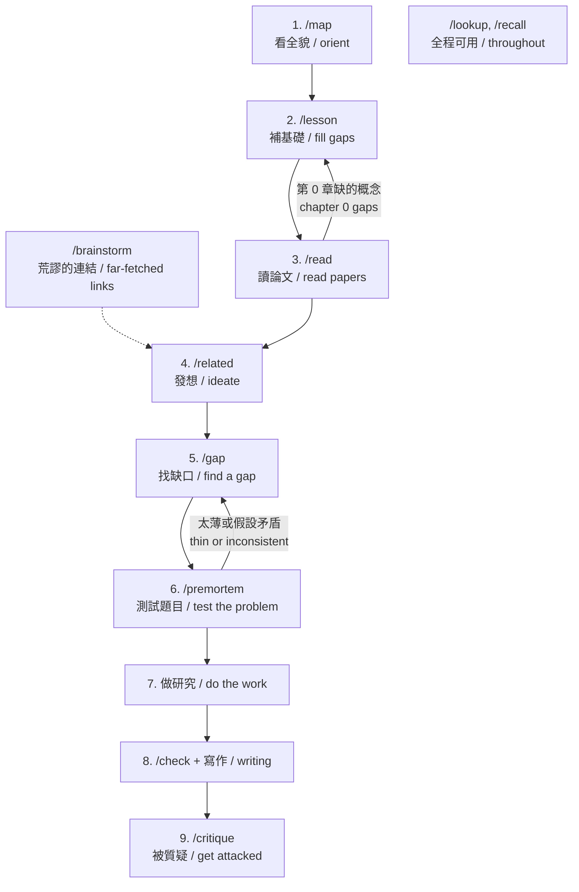

# researchy:設計與學習流程報告 / Design and learning-flow report

狀態日期 / Status as of: 2026-11-22

## 1. 定位 / Positioning

**中文:** researchy 是一組 Claude Code skill,輔助研究生走完研究過程:認識一個領域、讀論文、找題目並測試它、實際做研究。它是輔助工具,重點放在學習者的舒適度,以及減少研究過程中的痛點。它不代替學習者思考。

**English:** researchy is a set of Claude Code skills that assist a graduate student through research: getting to know a field, reading papers, finding and testing a problem, and doing the work. It is an assistive tool, focused on the learner's comfort and on easing the pain points of research. It does not do the learner's thinking.

## 2. 四個設計原則 / Four design principles

**中文:**

1. **勞力歸 agent,判斷歸學習者。** 搜尋、抓取、排序、查證、記錄由 agent 做。理解、選題、論證由學習者做,agent 只在之後補充或反駁。
2. **每條陳述都標示查到哪一級。** 目標不是阻止幻覺(做不到),而是讓它看得見。
   - `quote-verified`:引句已在原文中找到。
   - `source-exists`:來源已在本次 session 開啟,內容未逐句比對。
   - `model-only`:模型自己說的,沒有查證。
3. **學習者先答。** 學概念前先預測,讀單元前先回答一個問題,之後用自己的話重述。卡片上記的是學習者自己的話。
4. **偏題要看得見,但不禁止。** 支線先簡短回答再擱置,學習者決定要不要追。`/brainstorm` 是例外,那裡發散就是方法。

**English:**

1. **Labour to the agent, judgement to the learner.** The agent searches, fetches, orders, verifies and records. The learner understands, chooses and argues; the agent only adds to or attacks that afterwards.
2. **Every statement shows how far it was checked.** The goal is not to prevent invention (not achievable) but to make it visible.
   - `quote-verified`: the quoted text was found in the source.
   - `source-exists`: the source was opened in this session; its content was not compared line by line.
   - `model-only`: the model said so; nothing was checked.
3. **The learner answers first.** Predict before learning a concept, answer a question before reading a unit, restate in your own words afterwards. The card holds the learner's own words.
4. **Drift is made visible, not forbidden.** A tangent gets a short answer and is parked; the learner decides whether to follow it. `/brainstorm` is the exception: there, wandering is the method.

## 3. 目前的 skill / Current skills

| Skill | 用途 / Purpose | 產出 / Output | 狀態 / Status |
|---|---|---|---|
| `/map <主題>` | 把大主題拆成一堂課大小的方向 / Split a broad topic into lesson-sized branches | `maps/<name>.md` | 已建,已用於 TFM / built, used on TFM |
| `/lesson <主題>` | 一次學一個概念:預測、講解、重述 / One concept: predict, explain, restate | `lessons/NNNN-*.md`、概念卡片 / concept card | 已建,尚未跑完一堂 / built, no lesson finished |
| `/read <arXiv ID>` | 用閱讀指南讀論文,追引用時保留位置 / Read with a guide; keep your place when chasing citations | `guides/<id>.md`、論文卡片 / paper card | 已建;指南與頁面已做,共讀流程未跑 / built; guide and page made, reading loop not run |
| `/lookup <詞>` | 從自己的筆記 recap 學過的東西 / Recap from your own notes | 無 / none | 已建,未跑 / built, not run |
| `/brainstorm <想法>` | 認真討論荒謬的跨領域連結,先不評價 / Take far-fetched cross-field links seriously, no verdicts yet | `ideas/NNNN-*.md` | 已建,未跑 / built, not run |

**已設計、未建 / Designed, not built**

| Skill | 用途 / Purpose |
|---|---|
| `/related` | 發想用的相關研究工作文件,每條帶等級標籤 / Working document of related work for ideation, every line graded |
| `/gap` | 把論文卡片排成表,空格即候選題目 / Lay paper cards out as a table; empty cells are candidate problems |
| `/premortem` | 投入前測試題目:厚度、假設一致性、停損條件 / Test a problem before committing: thickness, assumption consistency, stop condition |
| `/check` | 把 `source-exists` 升為 `quote-verified` / Raise `source-exists` to `quote-verified` |
| `/recall` | 回想練習 / Recall practice |
| 階段 7 / Stage 7 | 做研究時的輔助,尚未設計 / Support while doing the research, not designed |

## 4. 檔案與工具 / Files and tools

| 路徑 / Path | 內容 / Holds |
|---|---|
| `library/` | 概念卡片與論文卡片,平放。分類與關聯寫在卡片裡,`INDEX.md` 由腳本產生 / Concept and paper cards, flat. Topics and links live in the card; `INDEX.md` is generated |
| `lessons/` | 每堂課的過程:猜測、講解、擱置的問題 / The process of each lesson: guess, explanation, parked questions |
| `maps/` | 主題地圖 / Topic maps |
| `guides/` | 論文閱讀指南 / Reading guides |
| `ideas/` | Brainstorm 筆記,整份視為推測 / Brainstorm notes, all treated as speculation |
| `papers/` | 下載的論文與產生的閱讀頁面。**不進 git**,因為多數論文可讀但不可再散布 / Downloaded papers and generated reader pages. **Not in git**: most papers may be read but not redistributed |
| `PARKED.md` | 擱置的問題 / Parked questions |

| 腳本 / Script | 作用 / Does |
|---|---|
| `scripts/library.py check` / `index` | 驗證卡片;重建 `INDEX.md` / Validate cards; rebuild `INDEX.md` |
| `scripts/arxiv.py meta` / `get` | 確認論文存在;下載全文 / Confirm a paper exists; download it |
| `scripts/build_reader.py <id>` | 把論文和閱讀指南組成反白說明頁面 / Join a paper and its guide into the highlight-to-explain page |

卡片之間的關聯有五種:`prerequisite`、`special-case-of`、`used-in`、`related`、`contrasts-with`。連到還沒有卡片的概念不算錯誤,它們列在索引的 Frontier 區。

Cards link to each other in five ways: `prerequisite`, `special-case-of`, `used-in`, `related`, `contrasts-with`. A link to a concept with no card yet is not an error; such targets are listed under Frontier in the index.

## 5. 學習場景的流程 / The learning flow

| 階段 / Stage | 學習者做什麼 / What the learner does | Skill | 狀態 / Status |
|---|---|---|---|
| 1. 看全貌 / Orient | 問這個領域有哪些方向,選一個 / Ask what directions exist, pick one | `/map` | 已建 / built |
| 2. 補基礎 / Fill gaps | 先預測,聽講解,用自己的話重述 / Predict, hear the explanation, restate | `/lesson` | 已建 / built |
| 3. 讀論文 / Read | 先看第 0 章缺什麼;照指南順序讀原文;看不懂就反白 / Check chapter 0; read the original in guide order; highlight what is unclear | `/read` | 已建 / built |
| 4. 發想 / Ideate | 看別人怎麼做,討論哪裡能延伸 / See how others did it, discuss extensions | `/related`, `/brainstorm` | 部分 / partly |
| 5. 找缺口 / Find a gap | 看論文卡片排成的表,判斷哪個空格值得做 / Look at the table of paper cards, judge which empty cell is worth doing | `/gap` | 未建 / not built |
| 6. 測試題目 / Test | 寫理想狀況的摘要、列假設、定停損條件;拿一頁紙問指導教授 / Write the best-case abstract, list assumptions, set a stop condition; take one page to the advisor | `/premortem` | 未建 / not built |
| 7. 做研究 / Do the work | 證明、實驗、資料分析 / Proofs, experiments, data analysis | 未設計 / not designed | 未建 / not built |
| 8. 寫作 / Write | 寫稿,每個引用過查證 / Draft, with every citation checked | `/check` | 未建 / not built |
| 9. 被質疑 / Get attacked | 全新 session 扮演審稿人 / A fresh session plays the reviewer | `/critique` | 只有想法 / idea only |

### 一堂 lesson 內部 / Inside one lesson

**中文:** 訂主題與一句範圍 → 學習者先預測 → agent 講解(每條陳述帶等級)→ 學習者用自己的話重述 → 產生卡片。途中的問題分三種:主題內直接答;缺口用幾句話補上再回來;支線簡短回答後記入 `PARKED.md`。同一條支線追問第二次,或缺口連到另一個缺口時,agent 提醒已偏題,由學習者決定擱置或換主題。

**English:** Fix a topic and a one-sentence scope → the learner predicts → the agent explains (each statement graded) → the learner restates in their own words → a card is created. Questions along the way are of three kinds: on topic, answered directly; a gap, filled in a few sentences before returning; a tangent, answered briefly and written to `PARKED.md`. On a second follow-up to the same tangent, or when one gap leads to another, the agent says the session has drifted, and the learner chooses to park it or switch topic.

### 讀一篇論文的內部 / Inside reading one paper

**中文:**

1. `arxiv.py get` 下載論文。
2. agent 讀過原文後建閱讀指南:把論文切成單元,找出每個單元需要什麼,排成「先備在前」的順序。論文用到但沒解釋、library 裡也沒有的概念列在第 0 章。
3. 學習者一次讀一個單元的**原文**。讀之前先回答該單元的問題。
4. 看不懂的地方:在閱讀頁面反白取得即時說明(標示為 `model-only`),提問會自動存下來。
5. 追引用時 agent 記下出發的那句話,在被引用的論文裡找出支撐它的段落,學習者讀完後回到原處。
6. 結束時產生論文卡片,固定記錄假設與作者自己說的未解問題。這兩欄是之後找缺口的原料。

**English:**

1. `arxiv.py get` downloads the paper.
2. After reading the text, the agent builds the reading guide: it cuts the paper into units, finds what each unit needs, and orders them so that prerequisites come first. Concepts the paper uses without explaining, and which the library lacks, go into chapter 0.
3. The learner reads the **original text** one unit at a time, answering that unit's question first.
4. For anything unclear: highlight it on the reader page for an instant explanation (labelled `model-only`); the question is saved automatically.
5. When a citation is followed, the agent records the sentence it started from, finds the passage in the cited paper that supports it, and the learner reads that and returns.
6. At the end a paper card is created, always recording the assumptions and the open problems the authors themselves state. Those two fields are the raw material for finding gaps later.

## 6. 已經實際做過的 / What has actually been done

**中文:** 以 transaction fee mechanism(TFM)為例走了前三個階段的一部分:

- **地圖**:`maps/transaction-fee-mechanisms.md`,八個方向。13 篇論文經 arXiv API 確認存在;七個方向為 `source-exists`,MEV 方向仍是 `model-only`。
- **閱讀指南**:`guides/2106.01340.md`(Roughgarden, *Transaction Fee Mechanism Design*)。agent 完整讀了第 2、3 節,前 10 個單元據此建立;其餘單元只根據標題,標示為暫定。
- **閱讀頁面**:含論文全文、16 個單元卡片、第 0 章、反白說明、提問紀錄。只有擁有者看得到。這篇論文的授權不允許再散布,所以頁面不可分享。
- **Lesson 0001**:已開場,停在學習者的預測。

**English:** Using transaction fee mechanisms (TFM) as the example, part of the first three stages has been walked:

- **Map**: `maps/transaction-fee-mechanisms.md`, eight branches. Thirteen papers were confirmed to exist through the arXiv API; seven branches are `source-exists`, and the MEV branch is still `model-only`.
- **Reading guide**: `guides/2106.01340.md` (Roughgarden, *Transaction Fee Mechanism Design*). The agent read sections 2 and 3 in full and built the first 10 units from them; the remaining units rest on headings only and are marked provisional.
- **Reader page**: the paper's full text, 16 unit cards, chapter 0, highlight-to-explain, and a log of questions. Visible only to its owner. This paper's licence does not allow redistribution, so the page must not be shared.
- **Lesson 0001**: opened, and paused at the learner's prediction.

## 7. 驗證到什麼程度 / How far this is verified

| 項目 / Item | 驗證方式 / How it was checked | 結果 / Result |
|---|---|---|
| 腳本(`library.py`、`arxiv.py`、`build_reader.py`)| 17 個自動測試 / 17 automated tests | 全部通過 / all pass |
| arXiv 抓取 / arXiv fetching | 對真實論文執行 / Run on real papers | 可用 / works |
| 閱讀頁面的版面與反白流程 / Reader page layout and highlight flow | 瀏覽器測試,桌機與手機寬度,用假的 Claude 介面 / Browser test at desktop and phone widths, with a stand-in for the Claude interface | 通過,無錯誤訊息 / passed, no console errors |
| 閱讀頁面向真正的 Claude 提問 / Reader page asking the real Claude | 無法由 agent 測試,需學習者在頁面上操作 / Cannot be tested by the agent; needs the learner on the page | **未驗證 / not verified** |
| 閱讀頁面的資料庫 / Reader page database | 發布後讀取兩個集合 / Read both collections after publishing | 可讀取,目前為空 / readable, currently empty |
| 所有 skill 的對話流程 / The conversational flow of every skill | 只有實際使用才能驗證 / Only real use can verify it | **多數未驗證 / mostly not verified** |

## 8. 已知的缺口 / Known gaps

**中文:**

1. **後半段是空的。** 階段 5 到 9 沒有可用的 skill。
2. **`quote-verified` 還沒有任何東西能產生。** `/check` 未建,所以目前最高只到 `source-exists`。
3. **階段之間的銜接沒測過。** 例如 `/gap` 假設論文卡片的欄位一致,但還沒有任何論文卡片存在。
4. **重排的效果只在一篇論文上看過。** 那篇本身很有條理,重排幅度很小,主要價值在第 0 章。對結構較亂的論文是否更有用,未知。
5. **依賴關係是 agent 推測的。** 閱讀指南的順序可能有錯;每個單元都指回原文,可以核對。
6. **反白說明沒有記憶,也不會提醒偏題。** 它只看得到反白的段落和周圍文字,看不到 library。

**English:**

1. **The second half is empty.** Stages 5 to 9 have no usable skill.
2. **Nothing can yet produce `quote-verified`.** `/check` is not built, so `source-exists` is currently the highest grade reached.
3. **The hand-offs between stages are untested.** `/gap`, for example, assumes paper cards have consistent fields, but no paper card exists yet.
4. **Reordering has been seen on one paper only.** That paper is well organised, so the reordering is small and the value lies mostly in chapter 0. Whether it helps more on a messier paper is unknown.
5. **Dependencies are inferred by the agent.** A guide's order may be wrong; every unit points back to the original so it can be checked.
6. **Highlight-to-explain has no memory and gives no drift reminder.** It sees only the highlighted passage and the text around it, not the library.
